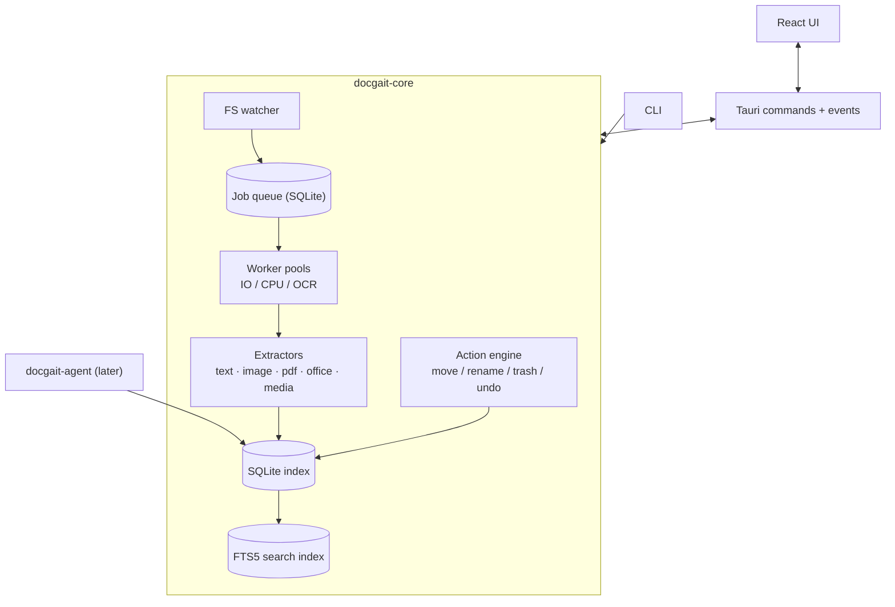

# docgait — Plan

A local-first desktop app for managing all kinds of files: merge scattered copies into one
organised library, remove duplicates, browse, search (including document contents), OCR scans,
convert formats, and later run an AI agent over documents.

**Progress** (2026-11-23): M0, M1 and M2 built (M2 in four PRs: import, clean-up, conflicts, organise).
M3 slice 1 (exact duplicates) built; similar images and similar documents next.

**Current priority**: merge several copies of the same data into one library and remove the
duplicates (§12, milestones M1–M3). Search and the other features are welcome outcomes but not
critical yet.

Based on [photo-bomb](../../photo-bomb) (sister repo). Same shape: Rust core library + CLI +
Tauri 2/React desktop app + SQLite index. This plan lists what is reused, what changes, and what
is new.

---

## 1. Goals

| # | Requirement | Summary of approach |
| --- | --- | --- |
| G1 | Support all file types, not just images | Index every file. Per-type "extractors" add text/metadata where possible; everything gets exact-duplicate detection |
| G2 | Simple search | One search box. SQLite FTS5 over filename, path, metadata, extracted text and OCR text, with a few optional filters (`type:pdf`, `in:Taxes`, `after:2024-01`) |
| G3 | Search document contents | Text extraction for PDF, Office, plain text, HTML, email, etc., stored in the FTS index |
| G4 | Indexing in the background, UI never blocked | Persistent job queue + worker threads; UI reads from its own DB connections; progress via throttled events |
| G5 | Browse all files | Folder tree + file list/grid + preview pane. Duplicates/similar files are *separate views*, not the only way in (photo-bomb only shows groups) |
| G6 | Relocate/organise files | Move, rename, new folder, drag and drop, bulk move, optional rule-based "organise" with a preview. Journaled, undoable |
| G7 | AI agent (deferred) | Summarise documents; find errors, mistakes and contradictions (within a document and across documents). Opt-in, per-document. Not built yet; no cloud features until then, but nothing blocks adding them (§17) |
| G8 | OCR | "Send for OCR" on any image/scanned PDF; text becomes searchable. Optional auto-OCR for PDFs with no text layer |
| G9 | Convert between formats | "Convert to…" on any file or selection (mp3 ↔ ogg, WordPerfect → Word, etc.). Runs as background jobs through pluggable engines (FFmpeg, LibreOffice, Pandoc, image codecs); always writes a new file, journaled and undoable |
| G10 | Ebooks and audiobooks | Book-aware metadata, browsing and search; ebook conversion (epub ↔ mobi/azw3/pdf…) via user-installed Calibre; audiobook merge/split/convert with chapters (mp3 ↔ m4b ↔ opus) via FFmpeg. DRM-protected files are never converted |
| G11 | Index only what matters | Per-source index level (names only by default, full, or agent); default excludes for SCM folders, build/dependency folders and OS/app cache files; honour `.gitignore`-style ignore files (§6) |
| G12 | People in photos | Import existing face tags (Picasa, XMP, Lightroom, digiKam, Windows Photo Gallery) and optionally detect and recognise faces locally; search photos by a person's name (§16) |
| G13 | Scale | Stay responsive from thousands to hundreds of millions of files (§7) |
| G14 | Libraries | One or more library folders (e.g. Personal, Work), kept separate; other sources are imported into it (merge trees, skip duplicates, keep conflicting variants as conflict files), then cleaned up as a separate step (§12). **Top priority** |

Carried over from photo-bomb: offline by default, no permanent delete, everything journaled and
undoable, nothing written into user folders unless the user asks for a move/rename.

## 2. Non-goals (v1)

- Cloud sync, multi-user, sharing.
- Editing document contents (it opens files in the default app).
- Replacing the OS file manager entirely. docgait manages one library folder plus the sources the user adds.
- Cloud features (agent, cloud OCR) for now — deferred, with extension points kept (§17).

---

## 3. What to reuse from photo-bomb

| photo-bomb piece | Reuse | Change |
| --- | --- | --- |
| `scan.rs` walk → diff → size/partial/full BLAKE3 funnel | As is | Remove image-only extension filter; split into separate queued stages (see §5) |
| `fsmeta.rs`, `trash.rs` | As is | — |
| `action.rs` (trash / move / hardlink, journal, undo, verify-before-act) | As is | Add `rename`, `mkdir`, `move-to-folder` without the "duplicate quarantine" framing; update index rows in place on move |
| `group.rs` exact + similar grouping, chain guard, ignore pairs | Mostly | Similar grouping generalised per file kind (images by pHash, documents by text MinHash) |
| `select.rs` auto-select keeper rules | As is | Add "has OCR text", "newest version" rules |
| `decode.rs`, perceptual hashing | As is, as the *image* extractor | — |
| `db.rs` | Starting point | New schema (§8); rename `photo` → `file`; move from ad hoc `add_column` to numbered migrations |
| Tauri shell, `photo://` URI scheme, React screens | Pattern | `file://`-style scheme becomes `doc://thumb/{id}`, `doc://preview/{id}`; new Browse and Search screens |
| CLI | Pattern | `docgait scan / search / ls / mv / ocr / dupes / similar / undo` |

Recommendation: **copy** the photo-bomb core into `crates/docgait-core` now rather than sharing a
crate. The two will diverge quickly (schema, job queue). Revisit extracting a shared
`fileops` crate (hashing, actions, journal, trash) once both are stable.

### Repository layout

```
crates/
  docgait-core/        # index, jobs, extractors, search, grouping, actions
  docgait-cli/
  docgait-agent/       # later: Claude API client + agent tasks (only crate with network)
apps/desktop/
  src-tauri/
  src/
design/                # long-lived design docs, split out of this plan once M1 starts
plan/
```

---

## 4. Architecture



### Key decisions

| Decision | Choice | Why |
| --- | --- | --- |
| Stack | Same as photo-bomb: Rust core, Tauri 2, React, SQLite | Proven in the sister repo; heavy work stays in Rust |
| Search engine | **SQLite FTS5** (bundled with rusqlite) behind a `SearchIndex` trait | One database, transactional with the index, good for up to ~10M files. **Tantivy** implements the same trait for very large libraries (§7) |
| Walking | ripgrep's `ignore` crate (parallel walker) | Fast parallel directory walk with `.gitignore`/`.ignore` support built in (§6) |
| Default index level | **Names only** | Cheap enough for any drive; the user opts sources into full or agent indexing (§6) |
| Faces | Local only: import existing tags, optional on-device detection/recognition | Face data is biometric and personal; it never leaves the machine (§16) |
| Background work | Persistent job table + dedicated worker threads | Survives restarts, can be paused, prioritised and retried; UI is never waiting on it |
| File identity | Row id stays stable across moves/renames done in-app; content hash matches moves done outside the app | Extracted text, OCR and agent results are expensive; never redo them for a move |
| OCR | Local only for now (macOS Vision, Tesseract on Debian); `OcrEngine` trait leaves room for a cloud engine later | Privacy; scans are often sensitive |
| Agent | Deferred. Will be a separate crate behind an `AgentProvider` trait, off by default, explicit consent | No cloud code now; the seams are there so it can be added without restructuring (§17) |
| Libraries | Several managed library folders (e.g. Personal, Work), each with its own index database and settings; other sources import into them | One merged structure without duplicates per area of life; work and personal kept apart, including different AI rules (§12) |
| Platforms | macOS first; must build and run on Debian from M0 | Developer uses both (§4 Platforms) |
| Pluggable engines | Converters, OCR engines and face models are all traits with a Settings tab to enable one or more | Easy to add, swap or remove an engine (e.g. for licence reasons) without code changes elsewhere |
| Conversion | Wrap proven external tools (FFmpeg, LibreOffice headless, Pandoc) behind a `Converter` trait; pure-Rust only for images | Writing format converters is a rabbit hole; these tools already handle hundreds of formats, including legacy ones like WordPerfect |

### Platforms

macOS is the primary platform. Debian must build and run from M0: CI builds a `.deb` (Tauri
`--bundles deb`) and runs the core tests on Linux; each milestone is checked by hand on Debian.
Windows still builds in CI (as photo-bomb does) but is not a target for now.

| Concern | macOS | Debian |
| --- | --- | --- |
| Build deps | Xcode CLT, Rust, Node, pnpm | `libwebkit2gtk-4.1-dev libgtk-3-dev librsvg2-dev libayatana-appindicator3-dev libssl-dev`, optional `libheif-dev` |
| Trash | `NSFileManager` (photo-bomb code) | freedesktop trash spec (`trash` crate, already used by photo-bomb off macOS) |
| Change detection | FSEvents (replay from last event ID) | inotify for the library; scheduled scans for large import sources |
| HEIC / RAW decoding | `sips` (photo-bomb) | libheif via `libheif-rs`; RAW via embedded previews |
| Created date | `birthtime` | `statx` btime where the filesystem records it |
| OCR | Apple Vision | Tesseract (`apt install tesseract-ocr`) |
| Face detection | Apple Vision or YuNet | YuNet |
| External tools | Homebrew: `ffmpeg`, `libreoffice`, `pandoc`, `calibre` | `apt`: same packages |
| App bundles (`.app`, `.photoslibrary`) | Treated as single items | n/a |

Platform-specific code sits behind small traits in `docgait-core` so the rest is shared.

---

## 5. Background indexing (G4)

The main lesson from photo-bomb: the scan was one long function holding the library and the UI
polled for refreshes. docgait splits work into small, independent, persisted jobs.

### Stages (each is a job kind)

Index level that runs each stage: N = names only, F = full, A = agent (§6).

| Priority | Job | Output | Why this order |
| --- | --- | --- | --- |
| 1 | `walk` (per source) · N F A | `file` rows: path, size, mtime, kind (by extension; magic bytes checked at F/A) | Browsing works as soon as this finishes — seconds |
| 2 | `fts_name` · N F A | Filename/path tokens in FTS | Filename search works almost immediately |
| 3 | `extract` (per file) · F A | Metadata + plain text into `file_text` + FTS | Content search fills in progressively |
| 4 | `thumb` (per file, lazy; background only at F A) | Thumbnail/preview image | Grid view |
| 5 | `hash` · F A (on demand at N) | Partial/full BLAKE3 (only for size collisions, as in photo-bomb) | Exact duplicates |
| 6 | `similar` · F A | pHash (images), MinHash/SimHash (text) + pairs | Similar files |
| 7 | `ocr` · on request; auto at F A if enabled | OCR text | Expensive; only on request or for text-less PDFs if auto-OCR is on |
| 8 | `convert` | New file in the target format | Only on request; user-triggered so it jumps ahead of background indexing |
| 9 | `faces` · F A if enabled for the source | Face regions, embeddings, imported names (§16) | After thumbnails; images only |
| 10 | `agent` · on request; automatic at A | Summaries / findings / captions | Only on request, or for every new/changed document at the agent level |

### Mechanics

- **Job table** in SQLite: `(id, kind, file_id, source_id, priority, state, attempts, error, not_before)`,
  used for **user-requested and per-source work** (walks, OCR, conversions, agent tasks). Enqueue is
  idempotent per `(kind, file_id)`. Failed jobs retry with back-off, then park as `failed`
  (visible in the UI, never blocking anything).
- **Bulk background work is state-driven**, not one job row per file: workers pick batches of
  files by status column (e.g. `text_state = 'pending'`, `hash_state = 'pending'`) in id order. This
  keeps the job table small at millions of files (§7). Which stages run for a file depends on its
  source's index level (§6).
- **Worker pools**: IO pool (walk, hash), CPU pool (extract, thumb, similar; `cores − 1`), OCR pool
  (1–2 threads). Threads run at low OS priority (`nice` / background QoS on macOS) so the machine
  stays responsive.
- **Database access**: WAL mode. One writer thread batches results (e.g. every 200 rows or 250 ms).
  Every UI command opens/uses its **own read connection** — never a shared `Mutex<Connection>`, so
  a long write never blocks a UI query.
- **Tauri**: every command is `async` and does its DB work on a blocking pool; no command waits
  for indexing.
- **Events**: `index.progress` (throttled to ~4/s: counts per stage, current file), `index.changed`
  (set of affected folder ids so the UI refreshes only the visible folder). No polling.
- **Controls**: pause / resume / cancel per stage; "pause while on battery"; CPU thread limit in
  Settings. A user-triggered action (open a file, OCR request, move) jumps the queue.
- **Incremental**: rescans touch only changed files (size + mtime), as in photo-bomb. Changes come
  from the OS change logs where possible — FSEvents on macOS (replayed from the last saved event ID,
  so changes made while docgait was closed are caught without a full walk), the NTFS USN journal on
  Windows, fanotify or scheduled scans on Linux (inotify cannot watch millions of folders). The
  `notify` crate is the fallback. A full rescan is only needed when the change log has a gap.
- **Moves outside the app**: a new file whose size + content hash matches a recently missing file
  inherits its row (text, OCR, tags, agent results) instead of being re-extracted.

---

## 6. Index levels and exclusions (G11)

### Index levels

Chosen when adding a source; **names only is the default**. It can be changed later, overridden
per folder (e.g. a backup drive at names only, but its `Documents` folder at full), and any single
file or folder can be "indexed fully now" on demand. Defaults by role (§12): the **library**
starts at Full; import and indexed sources start at Names only.

| Level | What it does | Reads file contents? | Typical use |
| --- | --- | --- | --- |
| **Names only** (default) | Walk: path, name, size, dates, kind by extension. Filename/path search, browse, organise | No | Big drives, backups, anything with millions of files |
| **Full** | Names only, plus: text extraction, metadata (EXIF, tags, document properties), thumbnails, hashing, exact/similar duplicates, auto-OCR (if enabled), faces (if enabled, §16) | Yes | Documents, photos, the folders you actually search |
| **Agent** | Full, plus: the configured AI agent (§17) summarises, tags and captions each new or changed document automatically | Yes, and sends selected content to the agent | Folders you want summarised/searchable by meaning. Only selectable once an agent is configured |

- The Add Source dialog shows the three levels with a one-line explanation each, plus a
  "Detect faces" checkbox under Full/Agent (off by default).
- Choosing **Agent** is the consent for that source: the dialog shows an estimated cost for the
  current contents, and a monthly spend cap applies. New documents are batched (Batch API) to keep
  cost down.
- **Upgrading** a level queues the extra work in the background. **Downgrading** stops it and
  offers to delete the derived data (text, thumbnails, summaries) to reclaim space.
- At names only, duplicates can still be found on demand ("Find duplicates in this folder"),
  which hashes just that folder.

### Default excludes

Excluded paths are not indexed and not shown in Browse (a "Show excluded" toggle lists them live
from disk, greyed out). The defaults are user-editable globally and per source, and any default
can be overridden with "Index anyway".

| Group | Excluded by default |
| --- | --- |
| SCM metadata folders | `.git`, `.hg`, `.svn`, `.bzr`, `_darcs`, `CVS`, `RCS`, `SCCS`, `.pijul`, `.jj` (Jujutsu), `.sl` (Sapling), `.fossil`/`_FOSSIL_`/`.fslckout`, `.repo`. The *working files* of a repository are still indexed |
| Dependencies and build output | `node_modules`, `bower_components`, `.venv`/`venv` (when it contains `pyvenv.cfg`), `__pycache__`, `.tox`, `.mypy_cache`, `.pytest_cache`, `.ruff_cache`, `.gradle`, `.m2/repository`, `.next`, `.nuxt`, `.svelte-kit`, `.parcel-cache`, `.terraform`, `Pods`, `DerivedData`, `target` (only next to `Cargo.toml`), `.cargo/registry` |
| macOS | `.DS_Store`, `._*` (AppleDouble), `.Spotlight-V100`, `.Trashes`, `.fseventsd`, `.TemporaryItems`, `.DocumentRevisions-V100`, `.VolumeIcon.icns`, `Icon\r`, `~/Library/Caches`, `~/.Trash` |
| Windows | `Thumbs.db`, `ehthumbs.db`, `desktop.ini`, `$RECYCLE.BIN`, `System Volume Information`, `%LOCALAPPDATA%\Temp`, `pagefile.sys`, `hiberfil.sys` |
| Linux | `.Trash-*`, `.directory` (KDE), `~/.cache`, `lost+found` |
| Temporary / lock files | `~$*` (Office lock files), `.~lock.*#` (LibreOffice), `*.swp`/`*.swo`, `*~`, `*.tmp`, `*.crdownload`, `*.part`, `*.download` |
| Editor / app config | `.obsidian` (Obsidian vault config, §18), `.idea`, `.vscode` workspace state |
| App caches and metadata | Browser caches, `.thumbnails`, `.picasa.ini`, `.picasaoriginals` (hidden from Browse, but `.picasa.ini` is still *read* for face tags, §16) |
| Packages | macOS bundles (`.app`, `.photoslibrary`, `.fcpbundle`…) are indexed as **one item**, not descended into |

### Ignore files

Honoured by default (can be turned off per source):

| File | Meaning |
| --- | --- |
| `.gitignore`, `.git/info/exclude`, the user's global git excludes file | Git ignore rules, applied even outside a git repo |
| `.hgignore` | Mercurial ignore rules (glob and regexp syntax) |
| `.bzrignore`, `.cvsignore` | Bazaar and CVS ignore lists |
| `.ignore`, `.rgignore` | Tool-neutral ignore files (ripgrep/fd convention) |
| `.docgaitignore` | docgait's own; same syntax as `.gitignore`; can also *un-ignore* (`!notes.txt`) things other ignore files exclude |
| `CACHEDIR.TAG` | [Cache directory tagging spec](https://bford.info/cachedir/): any folder containing it is skipped |
| `.nomedia` | Folder kept out of image/face views (still indexed by name) |

- Implemented with ripgrep's `ignore` crate, which already handles nested ignore files, negation,
  global excludes and parallel walking; Mercurial/Bazaar/CVS files are translated into the same
  matcher.
- Ignore files often exclude things people *do* care about (`.env`, local notes, data exports), so
  each source shows an **Excluded** summary: counts by reason ("12,400 files by .gitignore", "3
  folders by CACHEDIR.TAG"), with "Index anyway" per rule or folder.
- Changes to ignore files are picked up by the watcher; newly ignored files are removed from the
  index, newly un-ignored files are queued.

---

## 7. Scale and performance (G13)

Target: stay responsive from a few thousand files to hundreds of millions. Rough expectations (to
be confirmed by the 1M-file performance test, §21):

| Files | First walk (SSD) | Index size (names level) | Notes |
| --- | --- | --- | --- |
| 1M | ~10–60 s | ~0.5–1 GB | Plan as written |
| 10M | ~2–10 min | ~5–10 GB | Needs the measures below |
| 100M+ | ~20 min to hours (days over SMB) | ~50–100 GB plus text | Needs all measures below, and names-only for most of it |

Rescans after the first are near-constant time when the OS change log is used (§5).

| Measure | Why |
| --- | --- |
| **Names only by default** and default excludes (§6) | Most of a huge file count is junk or archives nobody searches by content |
| **State-driven background work** instead of a job row per file per stage (§5) | 100M files × several stages would be hundreds of millions of job rows |
| **OS change logs** (FSEvents, USN journal, fanotify) | No full rescans |
| **Fast bulk walking**: parallel walker; `getattrlistbulk` on macOS, MFT reading on Windows, `statx` on Linux | Per-file `stat` is the walk bottleneck |
| **Compact paths**: `file` stores `folder_id + name`, never the full path | Saves tens of GB at 100M files; moving a folder updates only folder rows and is **one** journal entry |
| **Keyset pagination** and indexes per sort column (`folder_id, name` / `mtime` / `size`); folder counts maintained incrementally | A folder with 1M files browses as fast as one with 100 |
| **Lazy thumbnails** packed into a few large cache files with an LRU size budget | 100M thumbnail files would be a small-file problem of its own |
| **Search behind a `SearchIndex` trait**: FTS5 by default, Tantivy for very large text indexes | FTS5 merges slow down at hundreds of GB of text; Tantivy segments scale better |
| **Similar detection with candidate generation** (LSH for text MinHash, multi-index hashing for image hashes) | All-pairs comparison is impossible at this size |
| **Optional per-source database files** (combined at query time) | Parallel writers; a removed or offline drive is just a detached file |
| **Content extraction prioritised for visible folders** | What you are looking at is ready first |
| **Network shares**: scheduled scans, never automatic full rescans | SMB `stat` runs at ~1–5k files/s |

---

## 8. Data model (draft)

```sql
-- Global app.db
CREATE TABLE library (id, name, root, db_path, created_at, settings_json);  -- §12

-- Per-library index.db (everything below)
CREATE TABLE source (
  id, root, volume_id, removable, last_scan_at,
  role TEXT,                         -- library | import | indexed (§12)
  index_level TEXT DEFAULT 'names',  -- names | full | agent (§6)
  faces_enabled INTEGER DEFAULT 0,   -- §16
  excludes TEXT,                     -- JSON: extra user patterns
  includes TEXT,                     -- JSON: "index anyway" overrides of default/ignore-file excludes
  honor_ignore_files INTEGER DEFAULT 1,
  fsevents_id INTEGER                -- last processed OS change-log position
);

CREATE TABLE folder (            -- for fast tree browsing and per-folder counts
  id INTEGER PRIMARY KEY, source_id, parent_id, rel_path, name, file_count, total_size,
  index_level TEXT               -- NULL = inherit from source; per-folder override
);

CREATE TABLE file (
  id INTEGER PRIMARY KEY,
  source_id, folder_id, name, ext,
  size, mtime_ns, dev, ino,
  kind TEXT,                     -- document | image | audio | video | archive | code | other
  mime TEXT,
  state TEXT,                    -- present | missing | trashed
  partial_hash BLOB, content_hash BLOB,
  -- type-specific metadata
  title, author, page_count, width, height, duration_ms, taken_at, created_at,
  text_state TEXT,               -- none | pending | extracted | no_text | needs_ocr | ocr_done | failed
  extract_error TEXT,
  phash INTEGER, dhash INTEGER, minhash BLOB,
  UNIQUE (source_id, folder_id, name)
);

CREATE TABLE file_text (         -- one row per file per origin
  file_id, origin TEXT,          -- 'extract' | 'ocr'
  engine TEXT, lang TEXT, text TEXT, pages_json TEXT,  -- page offsets, for "found on page 3"
  PRIMARY KEY (file_id, origin)
);

CREATE VIRTUAL TABLE file_fts USING fts5(
  name, path, title, author, body,
  content='', tokenize='unicode61 remove_diacritics 2'
);

CREATE TABLE tag (id, name UNIQUE);
CREATE TABLE file_tag (file_id, tag_id, PRIMARY KEY (file_id, tag_id));

CREATE TABLE similar_pair (a_id, b_id, kind, distance, PRIMARY KEY (a_id, b_id));
CREATE TABLE ignored_pair (hash_a, hash_b, created_at);
CREATE TABLE job (...);          -- §5
CREATE TABLE journal (...);      -- as photo-bomb, plus op in ('rename','mkdir')
CREATE TABLE ocr_request (id, file_id, engine, state, requested_at, finished_at, error);
CREATE TABLE conversion (        -- one row per requested conversion
  id, batch_id, source_file_id, target_format, preset, engine, engine_version,
  output_path, output_file_id, state, error, requested_at, finished_at
);
CREATE TABLE import_run (id, batch_id, source_ids_json, dest_folder_id, layout, mode, state,
  planned, copied, skipped_dup, conflicts, bytes, started_at, finished_at);
CREATE TABLE import_item (run_id, source_file_id, action, target_path, library_file_id, state, error);
  -- action: copy | move | skip_in_library | skip_dup_in_import | conflict | excluded
CREATE TABLE conflict (id, folder_id, base_name, state, reason, suggested_file_id, created_at, resolved_at, resolution);
  -- state: needs_review | suggested | resolved; reason: dates_unreliable | broken_variant | clear_newest
CREATE TABLE conflict_variant (conflict_id, file_id, origin_source_id, origin_path, health, PRIMARY KEY (conflict_id, file_id));
CREATE TABLE file_link (         -- provenance: "converted from", "OCR copy of", "imported from"
  from_file_id, to_file_id, kind, created_at, PRIMARY KEY (from_file_id, to_file_id, kind)
);
CREATE TABLE agent_result (      -- later
  id, file_id, task, model, prompt_version, content_hash, result_json, created_at
);
CREATE TABLE person (id, name, aliases_json, cover_face_id, created_at);       -- §16
CREATE TABLE face (
  id, file_id, content_hash, x, y, w, h,       -- region, normalised 0..1
  person_id, cluster_id,
  origin TEXT,                                  -- 'picasa' | 'xmp-mwg' | 'xmp-mp' | 'iptc' | 'digikam' | 'detected'
  confirmed INTEGER,                            -- user confirmed / rejected suggestion
  detector TEXT                                 -- model that found it (NULL for imported tags)
);
CREATE TABLE face_embedding (face_id, model TEXT, vector BLOB, PRIMARY KEY (face_id, model));
  -- one row per enabled recognition model; disabling a model deletes only its rows
CREATE TABLE setting (key, value);
```

- Agent results and OCR text are keyed by `content_hash` as well as `file_id`, so a byte-identical
  copy reuses them and a changed file invalidates them.
- Thumbnails/previews: OS cache dir, keyed by content hash (photo-bomb's design, which its POC did
  not finish).

---

## 9. File types and extraction (G1, G3)

Every file gets: path, size, dates, kind, MIME (extension + magic bytes via `infer`), exact-duplicate
hashing. Extractors add more where possible. Each extractor is versioned; bumping a version requeues
only its files.

| Kind | Formats | Text / metadata | Preview |
| --- | --- | --- | --- |
| Plain text | txt, md, csv, json, xml, yaml, log, source code | Read with encoding detection (`chardetng` + `encoding_rs`) | Text view, syntax highlight |
| PDF | pdf | Text layer + metadata via **pdfium** (`pdfium-render`, bundled lib); flag `needs_ocr` when pages have no text | Rendered pages (pdfium → image) or pdf.js in the webview |
| Office (OOXML) | docx, xlsx, pptx | Unzip + parse XML (`zip` + `quick-xml`); spreadsheets via `calamine` | Text preview; first-page thumbnail via OS QuickLook on macOS |
| OpenDocument | odt, ods, odp | Same approach as OOXML | Text preview |
| Legacy Office | doc, xls, ppt | `calamine` for xls; doc/ppt best-effort (or skip with "no text") | — |
| Legacy word processors | wpd (WordPerfect), wps, wri, lwp | Text via LibreOffice headless when installed (it uses libwpd/libwps); otherwise name only, with a "convert to read" hint | Converted PDF preview (cached) |
| Rich text / web | rtf, html, epub | Strip to text (`html2text`-style; epub = zip of html) | Sanitised HTML |
| Email | eml, mbox (later), msg (later) | Headers + body (`mail-parser`); attachments indexed as child entries | Header + body view |
| Images | jpg, png, heic, webp, tiff, … | Photo-bomb decoder + EXIF; OCR on request | Thumbnail |
| Audio / video | mp3, m4a, mp4, mov, … | Duration, tags (`lofty` for audio; `ffprobe` if present) | Poster frame (later) |
| Archives | zip, tar, 7z | List of contained names into FTS (not extracted to disk) | Listing |
| Other | anything | Name and path only | Icon |

Limits: cap extracted text per file (e.g. 5 MB) and time per file (watchdog kills a stuck parse
and marks it `failed`). Parsers run with `catch_unwind`; a crashing parser never takes down the
indexer.

---

## 10. Search (G2, G3)

One search box at the top of the window, always available, results as you type (debounced ~150 ms).

### Query language (simple by default)

| Input | Meaning |
| --- | --- |
| `lease renewal` | All words, anywhere (name, path, contents, OCR text) |
| `"lease renewal"` | Exact phrase |
| `-draft` | Exclude |
| `-"lease renewal"` | Exclude |
| `type:pdf` / `kind:image` | File type filter |
| `in:Taxes` | Under a folder (matches folder name or path) |
| `created-after:2024-01 created-before:2024-06` | Created (or document) date |
| `after:2024-01 before:2024-06` | Modified (or document) date |
| `tag:receipts` | Tag |
| `size:>10mb` | Size |
| `has:ocr` / `has:summary` | Has OCR text / agent summary |
| `person:"Jane Doe"` | Photos tagged with that person (§16). Plain words also match person names, so `jane beach` finds photos of Jane whose name/path/caption mention a beach |
| `person:jane person:bob` | Photos with both people |
| `has:faces` / `has:unnamed-faces` | Photos with any faces / faces not yet named |

Filters are also available as chips under the search box, so the syntax is optional.

### Implementation

- Parse the query in Rust into FTS5 `MATCH` + SQL `WHERE` on `file`. Prefix matching on the last
  word (`renew*`) for type-ahead.
- Rank with `bm25()` weighted: name > title > path > body. Recency as a tie-breaker.
- Results show filename, folder, type, date, and a **snippet** with the hit highlighted
  (`snippet()`), plus "page N" for PDFs using the stored page offsets.
- Clicking a result opens the preview scrolled/highlighted to the match; "Reveal in folder" jumps
  to it in Browse.
- Saved searches appear in the sidebar (cheap "smart folders").
- Search works on whatever is indexed so far; a small "indexing 4,210 files…" note tells the user
  results may grow.
- Later: semantic search (local embeddings, `sqlite-vec`) blended with BM25. Not in v1.

---

## 11. Browse (G5)

```
┌──────────────┬──────────────────────────────────────┬────────────────┐
│ [ search…  ] │ Taxes / 2024                 ▦ ☰   │  Preview       │
│ Sources      │ name          type  size  modified   │                │
│  ▸ Documents │ W2.pdf        PDF   80KB  2025-02-01 │  (page render) │
│  ▾ Taxes     │ 1099-INT.pdf  PDF   40KB  2025-02-03 │                │
│     2023     │ receipts/     —     12    …          │  Metadata      │
│     2024     │                                      │  Tags          │
│ Saved search │                                      │  OCR / Summary │
│ Duplicates   │                                      │                │
│ Similar      │                                      │                │
│ OCR queue    │                                      │                │
│ History      │                                      │                │
├──────────────┴──────────────────────────────────────┴────────────────┤
│ Indexing: extract 1,204 / 9,880 · OCR 2 queued      [pause]           │
└──────────────────────────────────────────────────────────────────────┘
```

- Folder tree from the `folder` table (instant, no disk walk); list and grid views, virtualised.
- Sort by name, type, size, date; filter by kind.
- Preview pane per kind (§9), metadata, tags, OCR text, agent summary (later).
- Open in default app, reveal in Finder/Explorer, copy path.
- Duplicates and Similar are separate sidebar views (photo-bomb's group screens, generalised).
  A file that has duplicates shows a small badge in Browse linking to its group.
- Browse works from the first second of a scan (rows appear after `walk`); text, thumbnails and
  badges fill in as jobs finish.

---

## 12. Library, import and organise (G6, G14)

**This is the current top priority**: merge several copies of the same data into one organised
structure, without duplicates. Search and the rest are welcome but secondary.

### Libraries

- A **library** is one folder that acts as an organised home for a set of files. There can be
  **several** (e.g. *Personal* and *Work*), kept fully separate. The first is created on first run;
  any library can be renamed or relocated later (one folder move, journaled).
- **Isolation**: each library has its **own index database** and its own thumbnail/cache folder
  (`<app data>/docgait/libraries/<id>/`). A small global `app.db` only lists the libraries and
  app-wide preferences. Removing a library from docgait deletes its index, never its files.
- **Per-library settings**:

| Setting | Why per library |
| --- | --- |
| **AI policy** (§17): agent off / local models only / allowed providers and models / API key | Work usually has different AI rules from personal |
| Default index levels, excludes, faces on/off | A work library may not want face recognition at all |
| Organise templates, import layout defaults | Different structures for different kinds of files |
| Cross-library visibility (off by default) | Whether this library's files may appear in "search all libraries" or as "also in library X" hints |

- The sidebar has a **library switcher**; Browse, Search, Duplicates and People are scoped to the
  current library. "Search all libraries" exists but only includes libraries that allow it.
- **Moving or copying files between libraries** is an explicit action (journaled). If the target
  library's AI policy is looser than the source's (e.g. Work → Personal with cloud agent enabled),
  docgait warns before moving.
- Every source belongs to one library. When importing, the user picks the **target library**; one
  import source (e.g. an old drive with mixed content) can feed several libraries, folder by folder.
- Within a library, every source has a role:

| Role | Purpose | Default index level |
| --- | --- | --- |
| **Library folder** | The organised home; what you browse and search day to day | Full |
| **Import source** | Somewhere to bring files *from*: old drives, backup copies, Downloads, a family member's laptop dump | Names only (files are hashed on demand when importing or checking duplicates) |
| **Indexed source** | Indexed in place, never imported (e.g. a shared folder you don't own) | Names only |

- Duplicate removal also works **in place** on any source (the Duplicates views, §20 M3), not only
  through import.

### Import / merge into the library

1. Select one or more import sources (or folders inside them) → **Import into library…**
2. **Layout**:
   - **Merge trees** (default; for copies of the same data): relative paths are combined, so
     `CopyA/Taxes/2023/W2.pdf` and `CopyB/Taxes/2023/W2.pdf` both map to `Library/Taxes/2023/W2.pdf`.
   - **Keep each source in its own folder**: `Library/Imported/<source name>/…`.
   - **Organise by template**: the same templates as rule-based organise (`{kind}/{year}/…`).
   - Plus a destination folder inside the library.
3. **Copy** (default; sources untouched) or **move**.
4. docgait hashes the selected files in the background (photo-bomb's size → partial → full funnel,
   compared against the library's hashes) and builds a **plan**:

| Case | Result |
| --- | --- |
| Content already in the library (any path) | Skipped; recorded as "already in library at …" |
| Same content several times in the import | Imported once; the copy chosen by photo-bomb's keeper rules (cleanest name → shortest path → oldest); the others recorded as duplicates |
| Same target path, different content | **Conflict**: all variants kept, side by side in the same folder (see *Conflicts* below) |
| Names differing only by case, on a case-insensitive volume (APFS default) | Treated as a conflict, as above |
| Anything else | Copied/moved to its target |

5. **Preview**: totals (files to import, duplicates skipped, conflicts, bytes), the resulting tree,
   and the conflict list. Change options and re-plan as often as needed.
6. **Execute** as a background job. Each copy is verified by hash before it counts. Dates
   (modified, and created where the filesystem supports it), Finder tags and extended attributes
   are preserved where possible. Free space is checked first; an interrupted import resumes; the
   whole import is journaled and undoable.

- **Idempotent**: re-running an import only brings in new or changed files. This doubles as a
  check: "Is everything on this drive already in my library?"
- Per-source status: *"92% in library · 310 duplicates · 14 conflicts · 120 excluded"*.

### Clean up sources after import

A **separate, explicit action** (same rule as conversion: copying in and removing originals are
never one step):

- **Clean up source…** lists files in the import source whose content is verified to exist in the
  library, then trashes them, or the whole source folder once it is 100% verified.
- Hashes are re-checked immediately before trashing. Files not in the library are never touched.
- Journaled and undoable; trash only, no permanent delete.

### Conflicts

Handled the way an IDE handles merge conflicts: nothing is lost, conflict files sit **next to the
file**, and a **Conflicts** tab is where they get cleaned up.

#### Conflict files

When an import maps different content to the same path:

```
Taxes/2023/W2.pdf                                  ← the suggested winner keeps the real name
Taxes/2023/W2.conflict-CopyB-2021-03-04.pdf        ← each other variant, same folder
Taxes/2023/W2.conflict-CopyC-2020-11-30.pdf
```

- Naming: `<name>.conflict-<source>-<modified date>.<ext>`. The extension stays last so the file
  still opens in its normal app; the `.conflict-` marker makes conflicts visible and searchable
  outside docgait too (`find . -name '*.conflict-*'`). If the name is taken, `-2`, `-3`… is added.
- Each conflict is also recorded in the index (`conflict` table) with all variants, their origin
  and the reason; a rescan recognises conflict files by the marker even if the index was rebuilt.

#### Choosing the suggested winner

1. **Healthy beats broken**: an empty, truncated or unopenable variant never takes the path; it is
   flagged.
2. Otherwise the **newest modified date** takes the path, **unless the dates can't be trusted**, in
   which case the conflict is marked **needs review** and no winner is claimed (the variant from
   the first-listed source keeps the path as a placeholder):
   - dates within a few seconds of each other (FAT/exFAT has 2-second precision);
   - dates differing by an exact number of hours (time zone / daylight-saving shift);
   - a date newer than the file it was copied from, or obviously reset (e.g. all files in a copy
     share one timestamp, or dates in the future / before 1990).
3. Conflicts with a clear winner are marked **suggested**.

#### Conflicts tab

- A badge in the sidebar shows the open count. The list is grouped by folder, filterable by
  *needs review* / *suggested* / *broken variant*, and by file type.
- Keyboard-driven like an IDE: next/previous conflict, accept left, accept right, open merge.
- **Accept all suggestions** resolves every *suggested* conflict in one step (journaled; one undo).
- Per conflict, the resolution options are:

| Option | Result |
| --- | --- |
| Keep current | The file at the real name stays; conflict variants go to the trash |
| Keep another variant | That variant takes the real name; the others go to the trash |
| Keep both / all | Variants are renamed to normal names the user picks (e.g. `W2 (corrected).pdf`); no longer conflicts |
| **Merge** (text files) | IDE-style merge editor; the result is saved to the real name, variants go to the trash |
| Mark resolved | Leave the files as they are, just close the conflict |

Every resolution is journaled and undoable; "go to the trash" is the OS trash, never a permanent
delete.

#### Compare and merge views

| File type | View |
| --- | --- |
| Text, Markdown, code, CSV, JSON, XML | **Merge editor**: two (or more) variants side by side with the result in the middle; changes highlighted by line and word; per-change *accept left / accept right / accept both*; the result is editable. When three or more copies exist and one is clearly older, it is used as the common base for a three-way merge, so non-overlapping changes merge automatically |
| PDF, Office, ebooks | Side-by-side preview plus a **diff of the extracted text** (page-aware for PDFs) to see what changed; resolution is whole-file (no merging inside binary formats). "Open both in default app" for a closer look |
| Images | photo-bomb's compare view: side by side, synced zoom/pan, flicker/overlay; dimensions, size, EXIF differences highlighted |
| Audio / video | Duration, bitrate, tags and cover compared; play either |
| Anything else | Size, dates, hashes, path; open either |

### Manual organise

- Drag and drop files/folders between folders in the tree or list.
- Cut/paste, "Move to…" (folder picker), rename (F2), new folder, bulk select.
- Moves within a source update the `file` row in place (same id → text, OCR, tags, agent results
  kept). Moves between sources change `source_id`. Moving outside all sources removes the row
  (after confirming).

### Rule-based organise (optional)

- Pick a selection or folder → choose a template, e.g. `{kind}/{year}/{month}`,
  `{year}/{tag}`, `{ext}` → **preview** the plan as a before/after tree → apply.
- Templates can use metadata (document date, EXIF date, author, tag, person in photo).
- Later: the agent suggests a folder and filename for a document ("2024-03 Acme invoice #4411.pdf"),
  shown as a plan the user approves — never applied automatically.

### Safety (from photo-bomb, enforced in core)

- Every move/rename is a journal entry, batch-undoable from History.
- Collision-safe names (`name (2).pdf`), never overwrite.
- Re-check size/mtime before acting; skip and report changed files.
- Cross-volume move = copy, verify hash, then trash the original.
- Offline sources are read-only; protected locations (Photos library, system folders) are
  scan-only.
- No permanent delete.
- Inside an Obsidian vault, moves and renames also update links in notes, in the same journal
  batch (§18).

---

## 13. OCR (G8)

- **Manual**: right-click → "Send for OCR" on images and PDFs (single or bulk). Appears in the
  **OCR queue** view with status.
- **Automatic (setting, off by default)**: OCR PDFs/images flagged `needs_ocr` during extraction.
- Runs as `ocr` jobs on their own small pool so it never starves normal indexing.

| Engine | Platform | Notes |
| --- | --- | --- |
| Apple Vision (`VNRecognizeTextRequest`) | macOS (default there) | Local, fast, good quality, free; via `objc2` (photo-bomb already uses objc2) |
| Tesseract | Debian (and macOS fallback) | Local; user-installed (`apt install tesseract-ocr`, Homebrew); language packs selectable |
| Cloud engines | — | **Not built now.** The `OcrEngine` trait and the OCR engines settings tab (enable one or more, set order) let one be added later |

- PDF pages are rendered with pdfium at ~300 DPI, then OCR'd page by page; text stored in
  `file_text(origin='ocr')` with page offsets, then FTS updated.
- Optional "Create searchable PDF copy" (text layer added; e.g. via `ocrmypdf` if installed) is a
  separate, explicit action that writes a **new file** next to the original — the original is
  never modified. It is implemented as a conversion (§14), so it shares the same queue, journal
  and provenance link.
- OCR results keyed by content hash: duplicates share them; a changed file re-queues.

---

## 14. Format conversion (G9)

### User experience

- Right-click a file or selection → **Convert to…** → shows only the target formats every selected
  file can reach with the engines installed (e.g. an mp3 offers ogg, opus, m4a, flac, wav).
- Pick a preset (e.g. *ogg — high quality*, *docx*, *PDF for archiving*) or open advanced options
  (bitrate, sample rate, image quality, page size).
- Choose the destination: **next to the original** (default), a chosen folder, or mirror the
  folder structure under a new root (for bulk conversions).
- The original is **always kept**. Conversion never removes or changes it; trashing the original
  is a separate, explicit action the user takes afterwards (e.g. from the Conversions view or
  Browse, with the usual journal and undo).
- Conversions run as background `convert` jobs with progress in the status bar and a
  **Conversions** view (queued / running / done / failed, with the engine's error output).
- The new file is indexed straight away and linked to its source ("Converted from W2.wpd"); the
  preview pane shows the link in both directions.
- Warnings shown before running:
  - Lossy → lossy (mp3 → ogg): "quality will not improve and may drop slightly".
  - Lossy → lossless (mp3 → flac): "file gets bigger, quality does not improve".
  - Document conversions that may lose layout (WordPerfect → docx, docx → md).

### Engines

Each engine implements a `Converter` trait:
`fn capabilities() -> Vec<(from, to)>`, `fn convert(input, output, options, cancel, progress)`.
The core builds the conversion matrix at startup from whatever engines are found, and can chain
two steps when there is no direct route (e.g. wpd → odt → md).

| Engine | Covers | Examples | How it is found |
| --- | --- | --- | --- |
| **FFmpeg** | Audio and video | mp3 ↔ ogg/opus/m4a/flac/wav, mov → mp4, video → audio, video → gif | **Installed by the user**, not bundled. Found on PATH or common locations (Homebrew, `/usr/local/bin`, Program Files), or a path set in Settings. Available encoders read from `ffmpeg -encoders` |
| **LibreOffice** (headless `soffice --convert-to`) | Office and legacy documents, spreadsheets, presentations | **wpd → docx**, doc → docx, docx ↔ odt, xls → xlsx, pptx → pdf, rtf → docx, any document → pdf | **Installed by the user**, not bundled. Detected in standard locations or a path set in Settings; Settings offers a download link |
| **Pandoc** | Markup and text documents | md ↔ docx/html/epub/odt, html → md, rst → docx | Installed by the user; detected |
| **Image** (Rust `image` crate; `sips` on macOS, libvips/ImageMagick if present) | Images | heic → jpg, png ↔ webp, tiff → pdf, resize on convert | Built in; extra formats via detected tools |
| **pdfium** (already bundled for extraction) | PDF → images, images → PDF | PDF pages → png, scans → one PDF | Built in |
| **ocrmypdf** | Scanned PDF → searchable PDF | §13 | Detected |
| **Archive** (Rust `zip`/`tar`/`sevenz`) | Archives | rar/7z → zip | Built in |
| **Calibre** (`ebook-convert`, `ebook-meta`) | Ebooks | epub ↔ mobi/azw3/fb2/pdf (see §15) | Installed by the user, not bundled; detected |

- Engines run as **child processes** with a timeout, low OS priority and a temp working
  directory, so a crash or hang never affects the app. Cancelling kills the process.
- LibreOffice gets its own profile directory and a pool of one or two instances (it does not like
  parallel runs on a shared profile).
- Settings → Converters lists each engine, its version, path and status, with "install" help for
  missing ones.

### Fidelity rules

- Copy metadata across where the target supports it: audio tags (title, artist, album, cover art),
  EXIF, document title/author, file dates (optional).
- Defaults favour quality: e.g. ogg Vorbis q6 / Opus 160 kbps for music, 300 DPI for PDF → image,
  PDF/A for "archive" presets.
- Output is **verified** before it counts as done: probe with FFmpeg / open with the extractor /
  check page count; a failed check deletes the partial output and marks the job failed.

### Safety

- Never overwrite: the output is written to a temp name, then renamed into place with
  collision-safe naming (`report (converted).docx`, `report (2).docx`).
- Every conversion is a journal entry (`op = 'create'`). Undo trashes the output. The original
  is never touched by a conversion.
- Offline and protected sources cannot be written to; the user is asked for another destination.
- Large batches (by file count or estimated output size) ask for confirmation and check free disk
  space first.

### CLI

```sh
docgait convert song.mp3 --to ogg                    # next to the original
docgait convert ~/Music/Old --to opus --preset music --dest ~/Music/Opus --mirror
docgait convert letter.wpd --to docx
docgait trash letter.wpd --yes                       # removing the original is always a separate step
docgait convert --formats song.mp3                   # list reachable targets
```

---

## 15. Ebooks and audiobooks (G10)

Ebooks and audiobooks are treated as first-class kinds (`ebook`, `audiobook`), not just
"documents" and "audio", because they have their own metadata (author, series, narrator, cover,
chapters) and their own conversions. Everything in §14 applies: user-installed engines, background
jobs, new file next to the original, original never removed, journaled and undoable.

### Ebooks

| Area | Plan |
| --- | --- |
| Formats | epub, mobi, azw3, fb2, pdf, txt, rtf, docx, html, cbz/cbr (comics) |
| Detection & metadata | Title, author(s), series + index, publisher, language, ISBN, cover image. epub/fb2/cbz parsed in Rust (zip + XML); mobi/azw3 via the `mobi` crate or Calibre's `ebook-meta` |
| Search | Full book text indexed in FTS (epub/fb2 in Rust; mobi/azw3 via Calibre when installed), with chapter names so a hit shows "Chapter 7" |
| Browse | Cover thumbnails; "Books" view grouped by author / series; filter by format |
| Duplicates | Same book in several formats (e.g. `Dune.epub` + `Dune.mobi`) grouped as a **format set** by title + author + ISBN — shown together, *not* flagged as duplicates to trash |

**Engine: Calibre `ebook-convert`** (installed by the user, not bundled; same policy as LibreOffice).
Pandoc covers md/docx/html ↔ epub when Calibre is missing.

| Conversion | Engine | Notes |
| --- | --- | --- |
| epub ↔ mobi / azw3 / fb2 | Calibre | Kindle presets (azw3; Send-to-Kindle now takes epub, so mobi is legacy) |
| epub / mobi / azw3 → pdf | Calibre | Page size / font size options for e-readers vs printing |
| pdf → epub | Calibre | Best effort; reflowing PDFs is lossy — warn |
| docx / md / html / txt → epub | Calibre or Pandoc | Title/author/cover taken from document metadata or entered in the dialog |
| cbz ↔ cbr ↔ pdf | Built in (archive + pdfium) | Comics are images; no re-encode needed |

- Metadata and cover always carried across; an **Edit book info** panel (title, author, series,
  cover) writes metadata into a *new* copy or, with explicit confirmation, into the file itself
  (journaled with a backup for undo).
- **DRM**: DRM-protected books (Kindle KFX/AZW with DRM, Adobe ADEPT epub, Apple FairPlay) are
  detected and shown as "protected". docgait indexes their names and metadata but does **not**
  convert them and does not remove DRM.

### Audiobooks

| Area | Plan |
| --- | --- |
| Formats | m4b (AAC with chapters), m4a, mp3 (single or a folder of parts), ogg/opus, flac |
| Recognising a book | A single m4b, **or** a folder of numbered audio files with the same album/author tags is grouped as **one audiobook** (parts in order) |
| Metadata | Title, author, narrator, series + index, year, description, cover, chapter list, total duration (tags via `lofty`, chapters via `ffprobe`) |
| Search | Title/author/narrator/series/chapter titles in FTS. Later: transcript search via local speech-to-text |
| Browse | "Audiobooks" view with covers, duration, chapter list in the preview pane, play a chapter in the preview |

**Engine: FFmpeg** (user-installed, already required for audio). Chapters written via FFmpeg's
metadata file; tags and cover via `lofty` after encoding.

| Operation | Example | Notes |
| --- | --- | --- |
| **Merge parts → one book** | 40 mp3 files → `Book.m4b` | Each part becomes a chapter (named from tags or filenames, editable in the dialog); cover and tags from the first part. Also available for any hand-picked files — see *Create audiobook from selected files* below |
| **Split book → parts** | `Book.m4b` → one mp3/opus per chapter | Files named `01 - Chapter title.mp3`, track numbers set |
| **Convert** | m4b ↔ mp3 / opus / ogg / m4a | Chapters preserved where the target supports them (m4b, ogg/opus, mp3 with ID3 CHAP); otherwise offered as split-per-chapter |
| **Re-encode for size** | 128 kbps mp3 → 64 kbps mono opus | Speech presets (mono, 48–64 kbps opus / 64 kbps AAC) — usually halves the size with no audible loss for narration |
| **Edit chapters** | Rename, move boundaries, add/remove | Writes a new file |

### Create audiobook from selected files

Select any audio files — in Browse, search results, or across folders — → right-click →
**Create audiobook…**. They don't need to be in one folder or already recognised as a book.

1. **Order** — files are listed in a suggested order (track/disc number tags, then natural filename
   sort: `Part 2` before `Part 10`). Drag to reorder, remove, or add more files.
2. **Chapters** — one chapter per file by default, titled from the track title tag or filename
   (cleaned of numbers and extensions); edit inline. Option: split a long file into chapters at
   detected silences.
3. **Book info** — title, author, narrator, series + number, year, description. Pre-filled from
   the files' common tags (album → title, artist → author); cover from embedded art, an image in
   the folder, or one the user picks.
4. **Output** — format (m4b default; mp3 or opus), quality preset (speech presets from above, or
   "keep original quality"), filename and destination (default: `Author/Title.m4b` under the first
   file's source).
5. **Preview & create** — shows total duration, chapter list, estimated size; creates as a
   background `convert` job.

- Mixed inputs (mp3 + m4a + flac, different sample rates/channels) are normalised to one
  format; files that already match the target codec are remuxed instead of re-encoded.
- Optional: loudness normalisation across parts (EBU R128 via FFmpeg `loudnorm`) so volume
  doesn't jump between chapters; optional short gap between chapters.
- The source files are left untouched (same rule as all conversions). The new book is linked to
  each source file ("Part of: Book.m4b"), and trashing the sources is a separate action.
- CLI: `docgait audiobook create part*.mp3 --title "…" --author "…" --to m4b`
  (`--order tags|name|given`, `--chapters-from tags|filename`).

### Long jobs and DRM

- Long jobs (a 20-hour book) report progress from FFmpeg's `-progress` output, can be cancelled,
  and use the original audio stream without re-encoding when the codec already fits (e.g. AAC
  parts → m4b is a remux, seconds instead of minutes).
- Lossy → lossy warnings as in §14; speech presets explain the trade-off.
- **DRM**: Audible `.aax`/`.aaxc` and other protected files are detected and shown as "protected";
  docgait does not convert them and does not remove DRM.

### Later

- **Ebook → audiobook** with text-to-speech (local engine, or a cloud voice with the same opt-in
  rules as the agent), producing an m4b with one chapter per ebook chapter.
- **Audiobook → text** (local speech-to-text) for transcript search and agent summaries.
- Sync reading position / "where was I" between the ebook and audiobook of the same title.

---

## 16. People and faces (G12)

Goal: type a person's name and get the photos they are in, like Picasa's face tags.

Off by default; enabled per source ("Detect faces" when adding a source at Full or Agent level,
§6). Everything runs **on the device**. Face data never leaves the machine, including when the AI
agent is enabled (Claude does not identify people from faces anyway; the agent can caption scenes,
not name people).

### 1. Import tags that already exist

Many libraries already have names attached to faces. These are imported first and are cheap
(metadata only, no image analysis):

| Source | Where it lives | Notes |
| --- | --- | --- |
| **Picasa** | `.picasa.ini` in each folder (`faces=rect64(…),<contact id>`), names in Picasa's `contacts.xml` | Read even though `.picasa.ini` is hidden from Browse. If `contacts.xml` is missing, the user names each contact id once |
| **XMP – MWG Regions** (`mwg-rs:Regions`) | Embedded in JPEG/HEIC/TIFF/DNG or a `.xmp` sidecar | Written by later Picasa versions, Lightroom, digiKam, darktable, Google tools, ACDSee |
| **XMP – Microsoft regions** (`MP:RegionInfo`) | Embedded | Windows Live Photo Gallery / Windows Photos |
| **IPTC Extension `PersonInImage`** | Embedded | Names without regions |
| **digiKam / Lightroom keywords** | `People/…` or `Persons/…` keyword hierarchies in XMP | Names without regions |
| **Apple Photos** | Photos library database (`Photos.sqlite`) | Read-only adapter, versioned by Photos schema. If a macOS update changes the format, the import reports "unsupported Photos version" and everything else keeps working; fix the adapter then |

Region coordinates are converted to the displayed orientation (EXIF rotation applied).

### 2. Detect and recognise new faces (optional)

| Step | How |
| --- | --- |
| Detect | Default **YuNet** (ONNX, via the `ort` crate) on macOS and Debian; Apple Vision selectable on macOS |
| Embed | Default **SFace** (ONNX, 128 numbers per face), run on the cropped, aligned face |
| Cluster | Group similar embeddings into unnamed "people" (e.g. HDBSCAN or Chinese Whispers), incrementally as photos are added |
| Name | User names a cluster or a single face ("This is Mom"). Imported tags from step 1 seed names automatically |
| Suggest | New faces close to a named person show as suggestions to confirm or reject; confirmed/rejected answers improve future suggestions |

- Runs as a `faces` stage after thumbnails (reuses the decoded image), on the CPU pool at low
  priority; GPU/Neural Engine used when available.
- Embeddings stored in the local DB, keyed by content hash so duplicate copies share them.
  ~0.5–2 KB per face; nearest-neighbour search via `sqlite-vec` or an HNSW index for large libraries.
- Model version stored per embedding; a model upgrade re-embeds in the background without losing
  names.

#### Face models settings tab

Settings → **Face models** lists the available detectors and recognisers. One detector is active
at a time; **one or more** recognisers can be enabled. Each enabled recogniser keeps its own
embeddings (`face_embedding`), and suggestions combine their votes (agreement = stronger
suggestion). Names belong to faces, not embeddings, so disabling or removing a model deletes only
its embeddings and never loses names.

| Model | Role | Licence | Shipped? | Notes |
| --- | --- | --- | --- | --- |
| **YuNet** (OpenCV Zoo) | Detector | MIT | Yes, default (~0.3 MB) | Fast, CPU-friendly, same on both platforms |
| Apple Vision | Detector | OS API | Built into macOS | macOS only |
| **SFace** (OpenCV Zoo) | Recogniser | Apache-2.0 | Yes, default (~37 MB) | Good accuracy, permissive licence |
| dlib ResNet (128-d) | Recogniser | Permissive (verify before shipping) | Optional add-on | Well-known, slightly older |
| InsightFace ArcFace (buffalo_l) | Recogniser | Non-commercial | **Not shipped**; user points to a downloaded model file | Best accuracy; fine for a free personal app, but kept out of the bundle so the licence never affects distribution |

- Models are loaded from a models folder through a small manifest (name, role, input size,
  licence), so adding or removing one is a file drop, not a code change.
- Licences are re-checked before each release that bundles a model.

### 3. Use it

- **Search**: `person:"Jane Doe"`, `person:jane person:bob` (together), `has:unnamed-faces`; plain
  words match person names too (§10).
- **People view**: one tile per person with a face thumbnail and photo count; open to see all their
  photos; "Unnamed people" clusters to work through; merge two people; rename; hide a person.
- **Photo preview**: face boxes with names on hover; click to name/correct; "not a face" to remove
  a false detection.
- **Organise rules** can use people: `{person}/{year}` (§12).
- **Write back (optional, explicit)**: write names and regions as MWG Regions into a `.xmp`
  sidecar (default) or into the file itself, so Lightroom, digiKam, etc. see them. Journaled and
  undoable; never automatic, since docgait otherwise writes nothing into user folders.

### Privacy

- Off by default; per-source opt-in.
- Biometric data (embeddings) is stored only in the local index, never exported with reports.
- **Delete all face data** in Settings removes every embedding, cluster and detected face (imported
  names in the files themselves are untouched).

---

## 17. AI agent (G7, deferred)

**Not built yet; no cloud features for now.** Nothing in milestones M0–M8 calls a network service.
To keep it easy to add later:

- All network code will live in `docgait-agent`; no other crate gets an HTTP client.
- **AI policy is per library** (§12): disabled (default), local models only, or a list of allowed
  providers/models with that library's own API key. Every agent call checks the policy of the
  library the file belongs to; a Work library set to "disabled" can never send anything, even if
  Personal allows it.
- An `AgentProvider` trait (Claude first; a local model possible) — the core only knows the trait.
- `agent_result` table, the `agent` job kind and the Agent index level exist in the design; the
  level stays greyed out until a provider is configured.
- The `OcrEngine` trait accepts a cloud engine the same way.

The design below is kept for when the work is picked up.

### Tasks

| Task | Input | Output |
| --- | --- | --- |
| Summarise | One document | Short summary + key points, stored and shown in preview; searchable (`has:summary`, summary text in FTS) |
| Review: errors and mistakes | One document | List of findings: arithmetic errors, wrong dates, inconsistent names/amounts, typos that change meaning — each with a quote and page reference |
| Contradictions within a document | One document | Pairs of statements that conflict, with both quotes |
| Contradictions across documents | A folder, selection, or saved search | Conflicting facts between documents (e.g. two contracts with different terms), with citations to each |
| Ask a question (later) | Selection | Answer with citations |

### Design

- Crate `docgait-agent`; the only code with network access. Off by default; enabled in Settings
  with an API key stored in the OS keychain.
- **Explicit consent**: nothing is sent unless the user runs a task on a document/selection. The UI
  shows what will be sent and an estimated cost before running.
- **Provider**: Claude API, model `claude-opus-5-5` by default (configurable), adaptive thinking,
  effort `high` for review/contradiction tasks and lower for summaries. Rust has no official
  Anthropic SDK, so the crate calls the Messages API over HTTPS (`reqwest`), with streaming.
- **Input**: PDFs sent as `document` blocks (Claude reads layout + images); other types sent as
  extracted text (including OCR text). Files API used to upload once and reuse across tasks.
- **Citations** enabled on document blocks so every finding points to a page/character range;
  the UI jumps to the cited spot in the preview.
- **Prompt caching** on the document block so running several tasks on the same document
  (summary, then review, then questions) reuses it cheaply.
- **Batch API** for bulk jobs ("summarise this folder of 300 documents") at lower cost; results
  arrive later and land through the normal job queue.
- **Cross-document contradictions**: don't send everything at once. First narrow candidates
  locally (shared entities, overlapping search terms, similar-text pairs), then a tool-using agent
  loop runs **locally** with tools such as `search_index`, `read_document(id, pages)`,
  `list_folder` — so it only reads what it needs and nothing leaves the machine without the user's
  selection covering it.
- **Results** stored in `agent_result` keyed by `(content_hash, task, prompt_version, model)`;
  stale results are marked when the file changes. Runs as `agent` jobs — never blocks the UI.
- **Guardrails**: findings are presented as suggestions with quotes, never auto-applied; large
  selections require confirmation; per-month spend cap setting.

---

## 18. Obsidian integration

docgait stays a **separate app**. Obsidian support is an integration, not a rewrite as a plugin:
an Obsidian plugin is limited to one vault, runs in Obsidian's UI process (heavy indexing would
freeze it), can't easily use the Rust core, and slows down on very large vaults.

### Vaults inside a library

- An Obsidian vault (a folder containing `.obsidian/`) can live inside a library or an import
  source. Its notes and attachments are indexed, de-duplicated and searched like any other files.
- `.obsidian/` (Obsidian's config, plugins, workspace state) is excluded by default (§6).
- docgait detects vaults and shows a vault badge on the folder in Browse.

### Link-safe moves and conflicts

- Obsidian notes link to files by name or path (`[[W2.pdf]]`, `![[scan.png]]`, `[text](path/W2.pdf)`).
  When docgait moves or renames a file inside a vault, it **updates links in the vault's notes**
  the same way Obsidian does (respecting the vault's "use shortest path / relative path"
  setting from `.obsidian/app.json`). The link edits are part of the same journal batch, so undo
  restores both the file and the notes.
- If links can't be updated safely (ambiguous names, unsupported link syntax), docgait warns and
  lists the notes that would break before moving.
- Moving a file **out** of a vault (to another folder or library) warns that links to it will break.
- Conflict files (`*.conflict-*`) created inside a vault are listed in the vault's
  `.obsidian/app.json` "Excluded files" (`userIgnoreFilters`) while they exist, so Obsidian doesn't
  treat them as duplicate notes or link targets; the entry is removed when the conflict is resolved.
- Duplicate clean-up inside a vault prefers keeping the copy that notes link to.

### Companion plugin (optional, later)

A small Obsidian plugin that only talks to a running docgait (local IPC/loopback API, or the CLI):

- Search docgait libraries from Obsidian, including PDF and OCR text.
- Insert a link or embed for a document from search results.
- Show a document's metadata, OCR text and (when the agent exists) summary in a side panel.
- No indexing in the plugin; docgait does the work. docgait works without Obsidian, and the plugin
  does nothing without docgait.

---

## 19. IPC surface (draft)

| Command | Purpose |
| --- | --- |
| `libraries.list / create / rename / relocate / remove / switch / settings.get / settings.set` | Libraries and per-library settings (AI policy, defaults, visibility) |
| `libraries.transfer(fileIds, targetLibrary, mode)` | Move/copy between libraries (policy warning) |
| `import.plan(sourceIds, dest, layout, mode)` / `import.execute(planId)` / `import.status(sourceId)` / `cleanup.plan(sourceId)` / `cleanup.execute(planId)` | Import and clean-up |
| `conflicts.list(filter)` / `conflicts.get(id)` / `conflicts.diff(id, a, b)` / `conflicts.resolve(id, resolution)` / `conflicts.acceptSuggestions(filter)` / `conflicts.saveMerge(id, text)` | Conflicts tab and merge editor |
| `engines.list(kind)` / `engines.setEnabled(kind, id, on)` / `engines.setOrder(kind, ids)` | Settings tabs for converters, OCR engines, face models |
| `sources.list / add(path, role, indexLevel, facesEnabled) / remove / setExcludes / setIncludes / setRemovable / setIndexLevel` | Sources |
| `folders.setIndexLevel(folderId, level)` / `excludes.preview(sourceId)` | Per-folder override; what is excluded and why |
| `people.list / get / rename / merge / delete` / `faces.forFile(id)` / `faces.cluster(clusterId)` / `faces.assign(faceIds, personId)` / `faces.reject(faceIds)` / `faces.importFrom(sourceId)` / `faces.deleteAll()` | People and faces |
| `index.status / pause / resume / rescan` | Background indexing control |
| `browse.tree(sourceId)` / `browse.list(folderId, sort, filter, page)` | Browse |
| `files.get(id)` / `files.text(id)` / `files.open(id)` / `files.reveal(id)` | Details |
| `search.query(q, page)` / `search.saved.list / save / delete` | Search |
| `ops.plan(ops[])` / `ops.execute(planId)` / `ops.undo(batchId)` | Move, rename, mkdir, trash |
| `organise.preview(selection, template)` | Rule-based organise |
| `tags.add / remove / list` | Tags |
| `groups.exact / similar / ignore` | Duplicates and similar (from photo-bomb) |
| `ocr.request(ids, engine)` / `ocr.queue()` / `ocr.cancel(id)` | OCR |
| `convert.targets(ids)` / `convert.plan(ids, format, preset, dest, original)` / `convert.execute(planId)` / `convert.queue()` / `convert.cancel(id)` | Format conversion |
| `converters.list()` | Installed engines, versions, status |
| `books.list(filter)` / `books.get(id)` / `books.editInfo(id, info)` | Ebook and audiobook views and metadata |
| `audiobook.merge(ids, chapters, format)` / `audiobook.split(id, format)` / `audiobook.chapters(id)` | Audiobook operations (run as `convert` jobs) |
| `agent.run(task, ids)` / `agent.results(id)` | Agent (later) |

Events: `index.progress`, `index.changed`, `ops.progress`, `ocr.progress`, `import.progress`, `convert.progress`, `faces.progress`, `agent.progress`, `error`.

---

## 20. Milestones

Order follows the current priority: merge several copies of the data into one library without
duplicates first. Content search, OCR, conversion and the rest follow. Every milestone's exit is
checked by hand on **macOS and Debian**.

### M0 — Bootstrap (≈ 1 week)
- Copy photo-bomb workspace; rename crates/app; strip image-only assumptions.
- New schema with numbered migrations; CI (fmt, clippy, tests, Prettier, ESLint) as in photo-bomb,
  building on macOS and Debian (plus a Windows build that is not hand-tested).
- **Exit**: app launches on macOS and Debian (`.deb` installs and runs); CLI `docgait scan <dir>`
  indexes every file (names/sizes only).

### M1 — Background indexing + Browse
- Job queue, state-driven bulk work, worker pools, writer thread, per-request read connections,
  throttled events.
- Parallel walker (`ignore` crate), default excludes, ignore-file support, `CACHEDIR.TAG`,
  "Excluded" view; index levels (names only default; full/agent levels light up as their
  milestones land).
- Folder tree, list/grid view (keyset paging), metadata pane, open/reveal.
- Filename/path search (names level) — enough to find things while organising.
- **Exit**: scanning a 100k-file folder; Browse usable within seconds; UI stays at 60 fps and every
  command responds < 100 ms during indexing (measured). An unchanged rescan finishes in seconds.
  A repo with `node_modules` and `.git` indexes only the working files.

### M2 — Library, import and organise
- Multiple libraries (own database each), library switcher, per-library settings; source roles
  (library folder / import / indexed); move/copy between libraries.
- Import plan: merge trees / own folder / template; copy or move; on-demand hashing;
  skip-if-already-in-library; in-import dedup with keeper rules; conflict files next to the original; preview;
  verified copies; resume; journal + undo.
- "Clean up source" (separate action), per-source "% in library" status.
- Conflicts tab: suggested-winner rules (healthy first, newest unless dates are unreliable),
  accept all suggestions, resolutions, merge editor for text, compare views for other types.
- Manual organise: move/rename/mkdir/drag-and-drop, bulk ops, in-place row updates; rule-based
  organise with preview; tags.
- Change detection for the library (FSEvents on macOS, inotify on Debian).
- Obsidian vault detection and link-safe moves/renames (§18), so organising never breaks notes.
- **Exit**: three overlapping copies of a test tree (shared files, files unique to each copy, and
  the same path edited differently) merge into one library where every unique file is present
  (verified by hash), no byte-identical duplicates exist, and each conflict appears as conflict files
  next to the original and in the Conflicts tab; a text conflict can be merged in the merge editor.
  Clean-up trashes only verified files. Undo restores everything.

### M3 — Duplicates
- Port photo-bomb's exact-duplicate views across the library and all sources; in-place cleanup;
  keeper rules; hard-link option; duplicate badge in Browse.
- Similar images (pHash/dHash) from photo-bomb; similar documents (MinHash) after.
- **Exit**: photo-bomb's accuracy on images; no group can be emptied; duplicates of library files
  found on import sources are shown as "safe to clean up".

### M4 — Extraction + content search
- Extractors: text, PDF (pdfium), OOXML, ODF, HTML/RTF, EML, image metadata.
- FTS5 index, query parser, snippets, filter chips, saved searches; CLI `docgait search`.
- Previews for text, PDF, images.
- **Exit**: content search returns ranked results with snippets < 100 ms on 100k files.

### M5 — OCR (local)
- OCR queue, Apple Vision (macOS), Tesseract (Debian; macOS fallback), auto-OCR setting,
  page-aware snippets, OCR engines settings tab.
- Optional searchable-PDF copy.
- **Exit**: scanned PDFs become searchable on both platforms; OCR never slows Browse/Search.

### M6 — Convert
- `Converter` trait, engine detection, conversion matrix with two-step routes.
- FFmpeg (audio/video), LibreOffice (WordPerfect, Office, → PDF), Pandoc (markup), image and
  pdfium engines; presets; metadata copy; output verification.
- Convert dialog, Conversions view, Settings → Converters, CLI `docgait convert`.
- WordPerfect/legacy text extraction via LibreOffice (feeds search).
- **Exit**: mp3 ↔ ogg keeps tags; a WordPerfect file converts to docx that opens in Word; a
  1,000-file batch runs without affecting Browse/Search; undo removes outputs; originals are
  never modified. With FFmpeg or LibreOffice not installed, their formats are hidden and Settings
  explains how to install them (Homebrew on macOS, `apt` on Debian).

### M7 — Ebooks and audiobooks
- `ebook` / `audiobook` kinds, metadata, covers, Books and Audiobooks views, format sets.
- Calibre engine (ebook conversion + metadata); Pandoc fallback; DRM detection.
- Audiobook grouping of multi-file books; "Create audiobook" from any selected files; merge → m4b
  with chapters, split by chapter, convert, speech presets, chapter editor.
- **Exit**: epub → azw3 keeps cover and metadata; 40 mp3 parts merge into one m4b with correct
  chapters and cover; hand-picked files from different folders and formats become one book in
  the chosen order; m4b splits back into chapter files; protected files are refused with a clear
  message.

### M8 — People and faces
- Import face tags from `.picasa.ini`, XMP (MWG and Microsoft regions), IPTC `PersonInImage`,
  digiKam/Lightroom keyword hierarchies, and the Apple Photos library (read-only adapter).
- Face models settings tab (§16); default YuNet + SFace via ONNX Runtime on both platforms;
  clustering, naming, suggestions, People view, `person:` search, face data wipe.
- Optional write-back of names to XMP sidecars (explicit, journaled).
- **Exit**: a Picasa-tagged library imports with names searchable; a 50k-photo library clusters
  locally with no network traffic; naming one face suggests the right matches; disabling a model
  removes only its embeddings.

### M9 — Agent (deferred; cloud)
- Not scheduled. Nothing before this milestone calls a network service; the extension points in
  §17 keep it addable later.
- When picked up: `docgait-agent` with a Claude provider, settings, keychain, consent UI,
  summarise, review, contradictions, citations, caching, batch; agent index level; optional cloud
  OCR engine; agent-suggested filenames/folders.
- **Exit**: findings cite the right page; no network traffic unless a task is run (verified).

### Later
- Obsidian companion plugin (§18).
- Semantic search (local embeddings), email archives (mbox/msg), audio transcription, version
  history ("this file replaced that one"), mobile.

---

## 21. Testing

| Area | Approach |
| --- | --- |
| Extractors | Fixture corpus per format (including corrupt/encrypted/huge files); golden text output; fuzz parsers |
| Job queue | Kill the process mid-scan, restart, verify resume and no duplicate work; retry/back-off |
| UI responsiveness | Automated test that issues browse/search commands during a large scan and asserts latency budget |
| Search | Query parser unit tests; ranking sanity tests on a labelled set |
| Actions | Photo-bomb's temp-dir integration tests, plus rename/mkdir/cross-source moves and row preservation |
| Library isolation | Two libraries: a file in Work never appears in Personal's browse/search/duplicates unless visibility is enabled; deleting a library removes only its index; agent policy checked per library (when the agent exists) |
| Library import | Overlapping copies with shared, unique and conflicting files; assert every unique content hash ends up in the library exactly once, conflicts produce correctly named conflict files and `conflict` rows, unreliable-date cases are marked needs review (FAT 2 s, exact-hour offsets, reset timestamps), broken variants never win, merge editor output saved correctly, re-import is a no-op, interrupted import resumes, clean-up never trashes an unverified file, undo restores; case-insensitive name clashes on APFS |
| Platforms | CI: core tests on macOS and Linux, `.deb` build; manual milestone check on Debian |
| OCR | Known scanned fixtures; character accuracy threshold per engine |
| Conversion | Fixture per route (mp3, ogg, flac, wpd, doc, docx, md, heic…); assert output opens, duration/page count matches, tags copied; engine-missing and engine-crash paths; cancel mid-run leaves no partial file; undo |
| Ebooks / audiobooks | Fixture books per format (with/without cover, series metadata); multi-part mp3 audiobook fixture; mixed-format hand-picked selection (order, chapter names, loudness); assert chapter count/titles/timestamps survive merge → split round trip; remux path used when codecs match; DRM fixtures refused |
| Exclusions | Fixture trees with `.gitignore`/`.ignore`/`.docgaitignore` (nested, negations), each SCM folder type, `CACHEDIR.TAG`, OS junk files; assert exactly the expected files are indexed; "index anyway" overrides |
| Index levels | Same tree at names/full/agent; assert which stages ran; upgrade and downgrade a source |
| Scale | Synthetic 1M-file tree: walk rate, rescan time, index size, browse latency in a 1M-file folder, search latency |
| Faces | Fixture photos with Picasa/XMP/IPTC tags; assert names, regions and rotation handling; clustering precision on a labelled set; "delete all face data" leaves nothing behind |
| Agent (when built) | Recorded API responses for unit tests; small eval set of documents with planted errors/contradictions to measure recall and false positives before each prompt change |

---

## 22. Open questions

None right now.

## 23. Decided

| Question | Decision |
| --- | --- |
| Bundle LibreOffice? | No. Separate install by the user; docgait detects it |
| Bundle FFmpeg? | No. Use the user's installed FFmpeg (run as a separate process); docgait detects it and its encoders |
| Convert + trash original in one step? | No. Always two separate actions; conversion never removes the original |
| External tools and app stores | Running user-installed tools is not allowed in the Mac App Store sandbox, so conversion with FFmpeg/LibreOffice/Pandoc/Calibre is a direct-download feature. A store build (if ever made) would hide those formats |
| Bundle Calibre? | No. Separate install by the user, same as LibreOffice |
| DRM-protected ebooks/audiobooks | Indexed (name, metadata) but never converted; docgait does not remove DRM |
| Default excludes | SCM folders, dependency/build folders, OS and app cache/junk files excluded by default; user-editable (§6) |
| Ignore files | `.gitignore` (and other SCMs' ignore files), `.ignore`, `.docgaitignore` and `CACHEDIR.TAG` honoured by default; can be turned off per source |
| Index level on add source | User picks names only (default), full, or agent; changeable later and overridable per folder |
| Browsing vs duplicates | Browse shows every file; duplicates/similar are separate views |
| Milestone order | Browse → library/import/organise → duplicates → content search and the rest |
| Libraries | Several libraries (e.g. Personal, Work), each with its own folder, index database and settings, including AI policy. Other sources are imported into them. In-place duplicate removal on sources is also supported |
| Platforms | macOS first; must build and run on Debian |
| Cloud (agent, cloud OCR) | Not now; keep extension points so it can be added later |
| Document type priority | None; all equal. The priority is merging copies and removing duplicates |
| Face models | Free app. Default YuNet + SFace (permissive licences); a Face models settings tab lets the user enable one or more; non-commercial models are user-supplied, never bundled |
| Import conflicts | Conflict files stay next to the file (`name.conflict-<source>-<date>.ext`), IDE style. Suggested winner keeps the real name: healthy beats broken, then newest, unless dates are unreliable (then *needs review*). Cleaned up in a Conflicts tab with accept-all-suggestions and a merge editor for text |
| Obsidian | Keep docgait a separate app. Later: vault-aware link-safe moves and an optional companion plugin that talks to docgait (§18) |
| Apple Photos people | Import read-only; fix the adapter if a macOS update breaks it |
